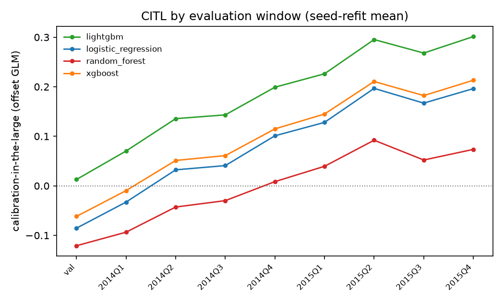
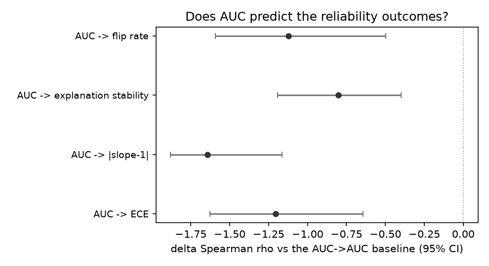
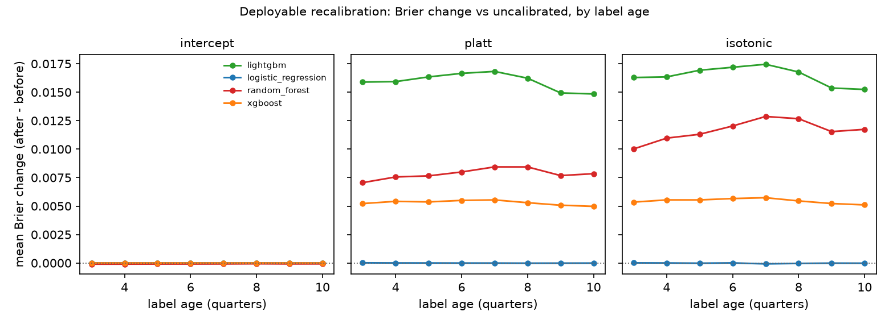
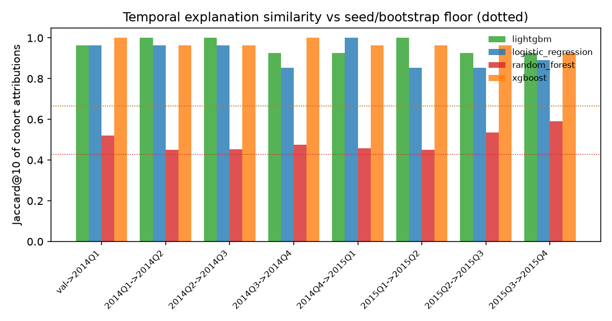

# credit-reliability-audit

**Does accuracy predict reliability? A temporal audit of calibration, explanations and decisions in credit-risk models.**

[](LICENSE)


An empirical study of three reliability properties of credit-risk models
under temporal distribution shift — **calibration**, **explanation
stability** and **decision stability** — measured on the *same* evaluation
cohorts, and tested against the question practitioners actually ask:
does a healthy AUC tell you anything about them?

The study is **complete**: protocol frozen and tagged (`protocol-v1`),
all four model families run to completion on real LendingClub loans,
all eight confirmatory hypothesis tests adjudicated, and the full
manuscript, claim register, tables and figures committed. Every
empirical number in the paper is exported mechanically from committed
tables — nothing is typed by hand.

---

## Headline results

Eight pre-registered tests, Holm-adjusted once over the family (α = 0.05),
cluster bootstrap over 20 deep-battery model configurations.

| ID | Question | Estimate [95% CI] | p (Holm) | Verdict |
|---|---|---|---|---|
| **H1a** | Does calibration-in-the-large change after validation? | **+0.0454** [+0.0161, +0.0821] | 0.002 | rejected — calibration deteriorated, heterogeneous by family |
| **H1c** | Does historical-label recalibration recover the within-cohort oracle gain? | **−13.66** [−25.96, −4.78] | 0.000 | rejected — estimate **negative**; the ratio's denominator (oracle gain) is tiny, so the deployable arms did not recover the gain and the tree families *increased* Brier score |
| **H2c** | Do group-level explanations move beyond the seed/bootstrap noise floor? | **0.083** (2 of 24 cells) [0.000, 0.208] | 0.261 | **not rejected** — the only confirmatory null that survives; most apparent explanation change is estimator noise |
| **H3a** | Does recalibration move decisions by more than reseeding the same model? | **−0.1025** [−0.1229, −0.0730] | 0.000 | rejected in the **opposite** direction — recalibration flips *fewer* loans than reseeding |
| **RQ4.1–4.4** | Does AUC in cohort *t* predict next-cohort reliability outcomes? | deltas −1.20 / −1.64 / −0.80 / −1.12 | 0.000 each | all rejected — AUC tracks future AUC (ρ ≈ 0.955) but not calibration, explanation stability or flip rate |

**Reading.** AUC is a screening statistic, not a reliability certificate.
Calibration drift is real but family-dependent. Group-level explanations
are far more stable than feature-level ones once you compare against an
explicit noise floor. And a recalibrator fitted on stale labels must be
checked against the uncalibrated score before deployment — on these
cohorts the tree-family arms made the scores worse.

## Key figures

| | |
|---|---|
|  |  |
| Calibration-in-the-large by cohort and family (Fig. 4) | RQ4: AUC vs reliability outcomes, paired deltas with 95% CIs (Fig. 8) |
|  |  |
| Recalibration arms: mean Brier change by family, arm and label age (Fig. 5) | Adjacent-cohort explanation agreement vs the seed/bootstrap floor (Fig. 6) |

Seven result figures live in [`reports/figures/`](reports/figures/) and are
rendered deterministically from committed tables by
[`scripts/run_real_figures.py`](scripts/run_real_figures.py).

## The paper

- [`paper/manuscript_rendered.md`](paper/manuscript_rendered.md) — the full
  manuscript with every value resolved.
- [`paper/claims.csv`](paper/claims.csv) — claim register: 34 empirical
  sentences, each tied to its evidence table and number keys (a test
  enforces exact substrings and key existence).
- [`protocol/HYPOTHESES.md`](protocol/HYPOTHESES.md) — pre-registered
  hypotheses; [`protocol/HYPOTHESES_VERDICTS.md`](protocol/HYPOTHESES_VERDICTS.md)
  — generated outcome record; [`protocol/DEVIATIONS.md`](protocol/DEVIATIONS.md)
  — three recorded post-freeze deviations (battery scale, lag axis,
  recovery-ratio companions).

## Repository layout

```
configs/        frozen splits, model families, search spaces, statistics, decisions
protocol/       frozen protocol, hypothesis register, deviations, gates
src/            loaders (leakage-guarded), features, models, calibration,
                explanations, decisions, statistics
scripts/        end-to-end pipeline (sweep → battery → statistics →
                tables → figures → numbers export → manuscript render)
reports/        committed result tables (reports/tables/) and figures
paper/          manuscript, numbers.json, claim register
tests/          243 tests: metric definitions, leakage guards, battery
                helpers, export adapters, renderer, reproducibility
notes/          STATUS, DECISIONS, REVIEWS (append-only review log)
data/           dataset provenance (raw file never committed)
```

## Reproducing

The raw LendingClub file is **not** redistributed (see
[`data/README.md`](data/README.md) for source, checksum and access date).
All result tables the paper needs **are** committed, so everything from
statistics onward rebuilds without raw data:

```powershell
git clone https://github.com/Culzz/credit-reliability-audit.git
cd credit-reliability-audit
uv sync                    # Python 3.11, locked environment

python -m uv run pytest -q          # 243 tests

# full pipeline from committed tables (deterministic, explicit seeds):
python -m uv run python -m scripts.run_real_statistics
python -m uv run python -m scripts.run_paper_tables
python -m uv run python -m scripts.report_verdicts
python -m uv run python -m scripts.run_real_figures
python -m uv run python -m scripts.export_numbers --source main
python -m uv run python -m scripts.render_paper --source main
```

With raw data (manual download, per [`data/README.md`](data/README.md)),
the earlier stages — `run_real_sweep`, `run_deep_battery` — also rebuild.

## Research discipline

- **Frozen protocol.** Cohorts, hypotheses, thresholds, estimators and the
  multiplicity family were fixed and tagged (`protocol-v1`) before any
  confirmatory result existed; the test-cohort loader refuses to serve test
  data until the freeze flag exists (`tests/test_protocol_lock.py`).
- **Noise floors.** Every temporal comparison (explanations, decisions) is
  reported against an empirical seed/bootstrap refit floor for the same
  configuration — an unfalsifiable "it changed" claim is converted into a
  test.
- **No hand-typed numbers.** The manuscript contains only
  `{{n:key}}` placeholders resolved by a strict renderer from
  `paper/numbers.json`, which is exported only from `reports/tables/`.
- **Explicit seeds only** (`BASE_SEED = 20180101`, `STAT_SEED = 20261109`);
  no `hash()`, no wall-clock seeding.
- **Negative results are results.** Non-rejections and wrong-direction
  findings (H2c, H3a) are reported with the same prominence.
- No bibliography yet: the literature gate (`protocol/GATE1.md`) is open
  and no reference enters the manuscript until verified against primary
  sources.

## License

MIT — see [LICENSE](LICENSE). The underlying LendingClub data is governed
by the source terms in [`data/README.md`](data/README.md) and is not
included in this repository.
